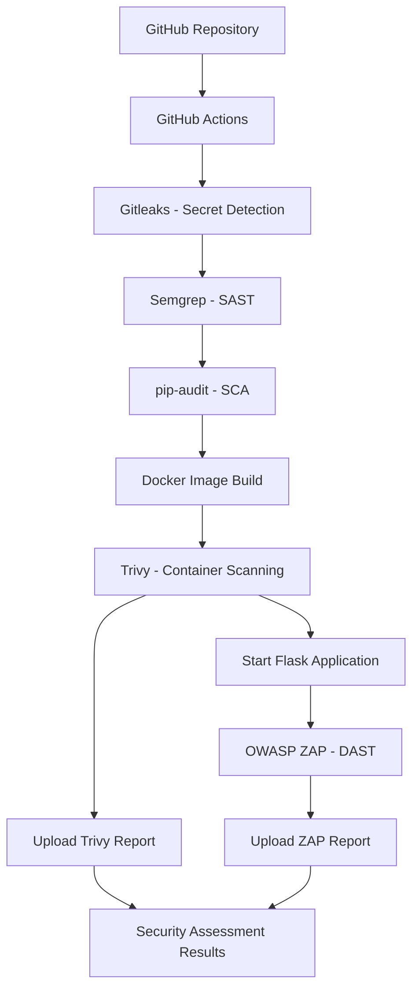

# Automated DevSecOps Pipeline

An application security project demonstrating how automated security testing can be integrated into a CI/CD workflow using GitHub Actions, with a deliberately vulnerable Flask application as the assessment target.

The pipeline combines secret detection, static application security testing (SAST), software composition analysis (SCA), container vulnerability scanning and dynamic application security testing (DAST).

The objective is to identify security weaknesses at different stages of the application lifecycle, document the findings and demonstrate selected remediation techniques.

## Project Overview

This project implements an automated security pipeline around a Python Flask application.

The application exposes four endpoints:

- `/login` – Authentication
- `/admin/users` – Administrative user listing
- `/search` – User search
- `/reset-password` – Password reset request

The application contains deliberately introduced security weaknesses to provide a practical target for security testing.

The pipeline runs automatically when code is pushed to, or a pull request is created against, the `main` branch.

## Security Objectives

- Detect accidentally committed secrets and credentials.
- Identify insecure coding patterns through static analysis.
- Audit Python dependencies for known vulnerabilities.
- Identify vulnerabilities in the built Docker image.
- Assess application behaviour and security headers through dynamic testing.
- Demonstrate secure coding and container hardening practices.
- Generate security reports that support vulnerability analysis and remediation.

## Architecture and Workflow

The pipeline follows this sequence:

1. Source code checkout.
2. Python environment setup and dependency installation.
3. Gitleaks secret detection.
4. Semgrep static application security testing.
5. pip-audit dependency vulnerability assessment.
6. Docker image build.
7. Trivy container vulnerability assessment.
8. Application deployment in a Docker container.
9. OWASP ZAP dynamic application security testing.
10. Report generation and artifact upload.
11. Application container cleanup.

### Pipeline Architecture



## Tools and Technologies

| Tool | Security Assessment | Purpose |
|---|---|---|
| GitHub Actions | CI/CD | Automates the security pipeline |
| Gitleaks | Secret Detection | Identifies exposed secrets in Git history and commits |
| Semgrep | SAST | Identifies potentially insecure coding patterns |
| pip-audit | SCA | Checks Python dependencies against known vulnerability advisories |
| Docker | Containerization | Packages and runs the application |
| Trivy | Container Security | Identifies vulnerabilities in OS and application packages |
| OWASP ZAP | DAST | Tests the running application for security weaknesses |

## Security Assessment Results

The following results are based on the generated scan reports and documented pipeline executions.

### 1. Secret Detection – Gitleaks

Gitleaks was integrated into the GitHub Actions workflow to detect exposed secrets.

**Latest-commit CI scan:**
- One commit scanned.
- No leaks detected.

A separate full-history scan was also performed during remediation practice.

It identified 242 private-key-pattern matches in historical test and generated report content. These findings were reviewed separately from the current working tree. The test credentials involved in the exercise were confirmed to be dummy values, not live credentials.

**Outcome:** Secret handling was improved by replacing the hardcoded JWT secret in the configuration file with environment-based retrieval. The historical scan report is excluded from Git tracking.

### 2. Static Application Security Testing – Semgrep

Semgrep was integrated to identify potentially insecure code patterns.

**Latest documented pipeline result:**
- 329 rules executed.
- Zero findings.

The pipeline uses:

`semgrep scan --config=auto --error .`

The `--error` option makes detected findings capable of failing the pipeline.

A targeted suppression was used for the Flask development server binding to `0.0.0.0`, which is required for the container's port mapping in this demonstration. This is not a recommendation to expose Flask's development server in production.

### 3. Software Composition Analysis – pip-audit

pip-audit was used to assess the Python dependencies declared in `requirements.txt`.

**Result:** No known vulnerabilities were reported in the specified requirements at the time of the documented scan.

The scan is configured to run as part of the pipeline.

### 4. Container Vulnerability Assessment – Trivy

Trivy was used to assess the built `vulnerable-app` Docker image.

**Scan environment:**
- Base image: Python 3.12 slim
- Detected operating system: Debian 13.7
- Scan type: Container image vulnerability assessment
- Report date: 11 November 2026

#### Operating System Findings

| Severity | Findings |
|---|---:|
| Critical | 0 |
| High | 49 |
| Medium | 75 |
| Low | 65 |
| Unknown | 15 |
| **Total** | **204** |

#### Python Package Findings

| Severity | Findings |
|---|---:|
| Critical | 1 |
| High | 5 |
| Medium | 2 |
| Low | 1 |
| **Total** | **9** |

Notable affected packages included:

- certifi – Critical
- msgpack – High
- setuptools – High, Medium and Low
- urllib3 – High and Medium

Trivy provided fixed-version information for the identified Python package vulnerabilities.

**Comparison with pip-audit:** Although pip-audit reported no known vulnerabilities in the declared requirements, Trivy identified vulnerable Python packages in the built image. These results have different scanning scopes and should not be treated as contradictory.

**Pipeline behaviour:** Trivy currently generates and uploads a report but does not enforce an explicit vulnerability-severity failure threshold.

Detailed analysis: [Trivy Findings](findings/trivy-findings.md)

### 5. Dynamic Application Security Testing – OWASP ZAP

OWASP ZAP was configured to assess the running Flask application.

The automated test plan exercises the following endpoints:

- `/login`
- `/admin/users`
- `/search`
- `/reset-password`

The scan includes request execution, passive scanning and a time-limited active scan against the login endpoint.

#### Notable Findings

| Finding | Risk |
|---|---|
| Content Security Policy Header Not Set | Medium |
| Missing Anti-clickjacking Header | Medium |
| Server Leaks Version Information | Low |
| X-Content-Type-Options Header Not Set | Low |
| Information Disclosure – Sensitive Information in URL | Informational |

The informational URL finding identified a potentially sensitive `user` pattern in a request URL.

These results highlight the importance of security headers, response configuration and avoiding sensitive information in URLs.

**Pipeline behaviour:** ZAP generates an HTML report and uploads it as a GitHub Actions artifact. The current configuration does not establish an explicit alert-severity threshold for failing the pipeline.

## Security Improvements Demonstrated

The project also includes selected secure coding and container-hardening changes.

| Area | Improvement |
|---|---|
| Secret management | Replaced a hardcoded JWT secret with environment-variable retrieval and explicit missing-secret validation |
| SQL injection prevention | Demonstrated a parameterized SQL query structure in the search endpoint |
| Response handling | Changed the password reset response to JSON |
| Container security | Created a dedicated application user and configured the Docker image to run as a non-root user |
| Repository hygiene | Excluded generated security reports and other unnecessary files from Git tracking |

The parameterized search example demonstrates the intended query structure; it does not execute a database-backed query. Similarly, the JSON response improves response handling but is not a universal XSS mitigation.

The application remains a security testing target, not a production-ready application. In particular, authentication and authorization still require further implementation.

## Accessing Generated Reports

The pipeline uploads generated reports as GitHub Actions artifacts.

To access them:

1. Open the repository on GitHub.
2. Navigate to **Actions**.
3. Select the relevant workflow execution.
4. Locate the Artifacts section.
5. Download the relevant report.

| Artifact | Description |
|---|---|
| `trivy-image-report` | Container vulnerability scan report |
| `zap-dast-report` | OWASP ZAP HTML assessment report |

The repository also contains detailed Trivy findings documentation in `findings/trivy-findings.md`.

## Running the Project Locally

### Prerequisites

- Python 3.12 or compatible version
- Docker
- Git
- A Linux, macOS or Windows environment with Docker support

### 1. Clone the Repository

```bash
git clone https://github.com/VeronicaPeters/Automated-DevSecOps--Pipeline.git
cd Automated-DevSecOps--Pipeline
```

### 2. Create and Activate a Virtual Environment

```bash
python3 -m venv venv
source venv/bin/activate
```

### 3. Install Dependencies

```bash
pip install -r requirements.txt
```

### 4. Configure the Environment Variable

For the configuration example:

```bash
export JWT_SECRET="$(python3 -c 'import secrets; print(secrets.token_urlsafe(32))')"
```

### 5. Build the Docker Image

```bash
docker build -t vulnerable-app .
```

### 6. Run the Application

```bash
docker run -d \
  --name vulnerable-app-container \
  -p 5001:5001 \
  -e JWT_SECRET="$JWT_SECRET" \
  vulnerable-app
```

Access the application at:

`http://localhost:5001`

Stop and remove the container when finished:

```bash
docker stop vulnerable-app-container
docker rm vulnerable-app-container
```

**Note:** This is a deliberately vulnerable demonstration application. Run it only in a controlled local environment. Do not expose it to the public internet or use real credentials or sensitive data.

## Pipeline Security Gates and Limitations

Not every scanner in this project currently enforces the same failure behaviour.

| Component | Current Behaviour |
|---|---|
| Gitleaks | Secret detection integrated into CI |
| Semgrep | Findings can fail the pipeline through `--error` |
| pip-audit | Vulnerable dependencies can fail the pipeline |
| Trivy | Report generation; no explicit vulnerability-based failure threshold |
| OWASP ZAP | Report generation; no explicit alert-severity failure threshold |

Other limitations include:

- The Flask application uses the development server and is not production-ready.
- Authentication and authorization require further implementation.
- The search endpoint demonstrates parameterized query construction but does not connect to a database.
- The ZAP active scan is scoped to the login endpoint.
- The container and operating system findings require further remediation and validation.
- Historical secret-pattern matches require contextual triage and should not automatically be treated as active credentials.

## Future Improvements

- Remediate outstanding OS and Python package vulnerabilities.
- Introduce severity-based Trivy and ZAP quality gates.
- Expand DAST coverage to additional endpoints and authentication scenarios.
- Implement proper authentication and authorization.
- Integrate a database-backed application with secure query execution.
- Replace the Flask development server with a production WSGI server.
- Improve security response headers and configuration.
- Add automated regression tests for remediated vulnerabilities.
- Improve report retention, trend analysis and vulnerability tracking.

## Key Takeaways

This project demonstrates practical experience integrating application security testing into a CI/CD workflow, interpreting findings from multiple security tools, understanding differences in scanning scope, and applying selected secure coding and container-hardening improvements.

It also demonstrates an important aspect of application security engineering: identifying vulnerabilities is only one part of the process. Understanding their context, validating findings, prioritising remediation and communicating residual risk are equally important.
